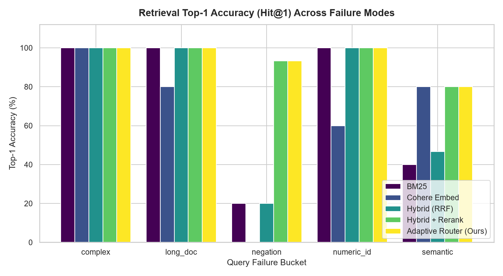
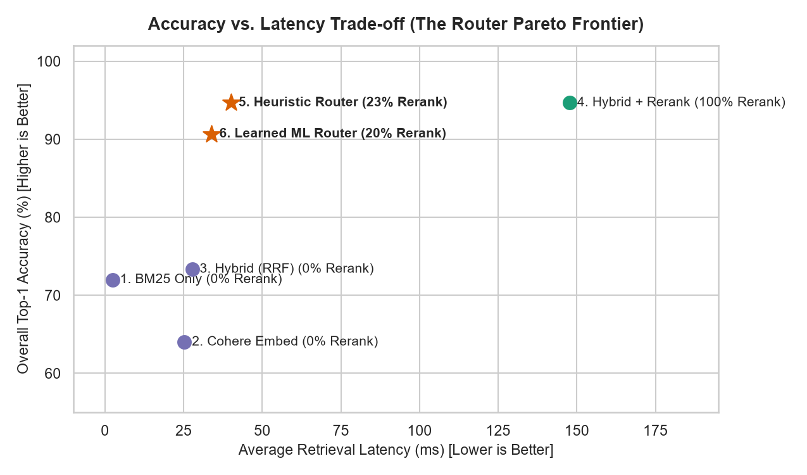

# Rerank vs. Embed vs. Hybrid Retrieval: A Failure-Mode Study & Adaptive Router

An empirical study measuring the exact failure boundaries of lexical search (BM25), dense vector embeddings (`embed-v4.0`), and cross-encoder reranking (`rerank-v3.5`) across 5 distinct query failure modes, culminating in a zero-cost production query router.

---

## 📊 Key Findings & System Comparison

We benchmarked 4 baseline strategies against 75 targeted failure queries across a 260-document technical corpus containing hard-negative distractor traps:

| Strategy | Top-1 Accuracy (Hit@1) | MRR@10 | Avg Latency (ms) | Rerank API Cost |
| :--- | :---: | :---: | :---: | :---: |
| **1. BM25 Only** | 72.0% | 0.797 | 2.4 ms | 0% |
| **2. Cohere Embed** | 64.0% | 0.804 | 25.2 ms | 0% |
| **3. Hybrid (RRF)** | 73.3% | 0.815 | 27.7 ms | 0% |
| **4. Hybrid + Rerank** | 94.7% | 0.953 | 147.7 ms | 100% |
| **5. Heuristic Router (Ours)** | **94.7%** | **0.962** | **40.0 ms** | **22.7%** |
| **6. Learned ML Router** | 90.7% | 0.918 | 33.9 ms | 20.0% |

---

## 📉 Failure Mode Taxonomy



1. **Strict Negation (`negation`):** Dense embeddings fail completely (**0% accuracy**) when queries include exclusion clauses (*"WITHOUT beta-adrenergic activation"*), walking straight into keyword-matching distractor traps. Cross-encoder reranking recovers accuracy to **93.3%**.
2. **Exact Alphanumeric IDs (`numeric_id`):** Dense embeddings lose **40% accuracy** on twin documents sharing semantic topics that differ only by firmware versions (`ERR-4050-B`). BM25 and Hybrid achieve **100%**.
3. **Needle in a Long Document (`long_doc`):** Embedding vectors suffer from vector dilution when short answers are buried inside lengthy background text, whereas lexical search remains precise.

---

## 🚀 The Adaptive Router Pareto Frontier



Rather than paying the latency and token cost of running `Hybrid + Rerank` on every query, our zero-cost query feature extractor inspects query structure (negation keywords, version regex patterns, and local BM25 confidence gaps in `0.5ms`) to route easy queries to free lexical/dense pipelines and hard queries to Cohere Rerank.

---

## 🛠️ Reproducibility & Setup

1. Clone and install dependencies:
   ```bash
   git clone [https://github.com/SlimmShadyyy/cohere-retrieval-router.git](https://github.com/SlimmShadyyy/cohere-retrieval-router.git)
   cd cohere-retrieval-router
   python -m venv .venv && source .venv/bin/activate  # Windows: .venv\Scripts\Activate.ps1
   pip install cohere rank-bm25 numpy pandas scikit-learn matplotlib seaborn tqdm python-dotenv datasets

2. Add your Cohere trial API key to .env:
    ```bash
    COHERE_API_KEY=your_key_here

3. Run the complete pipeline:
    ```bash
    python src/build_dataset.py
    python src/evaluate.py
    python src/router.py